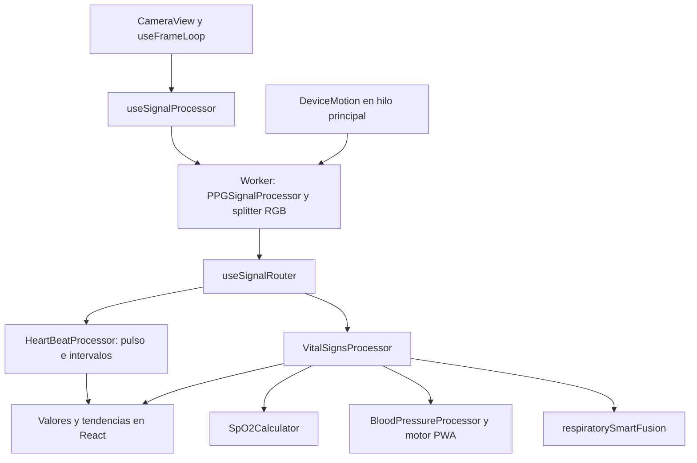

# BIO BEAT — Research & Engineering Blueprint v1

Fecha: 13 de noviembre de 2026. Repositorio: charly7978/bio-beat-tracker-041707cb. Base inspeccionada: `a12253134aa270cb18aa122a3fae093ae3cdff4e`.

**Resultado de esta entrega:** diseño técnico aplicado a los módulos actuales, con hipótesis médicas, contratos propuestos, experimentos y cambios delimitados. No modifica los estimadores productivos. Las observaciones de código se comprobaron sobre archivos del commit indicado; los objetivos experimentales todavía no son resultados de Bio Beat.

## 1. Objetivo de producto

Bio Beat debe mostrar números para pulso, SpO₂, presión sistólica/diastólica y frecuencia respiratoria cuando el estimador disponga de observaciones utilizables. El trabajo se orienta a extraer más información de los sensores y reducir el error frente a referencias reales.

Cada resultado debe conservar método, ventana de adquisición, antigüedad, calidad, calibración y versión del modelo. Un resultado experimental puede ser visible sin calibración, identificado como estimación. La falta de observaciones no se sustituye con una cifra normal predeterminada.

La innovación principal será aprender relaciones temporales y personales entre señales, preservando qué variable aporta cada sensor. Respiración y pulso pueden aportar contexto al modelo óptico; por sí solos no identifican la saturación. Una relación fisiológica plausible se convierte en una hipótesis que se compara contra un modelo base.

## 2. Estado real del repositorio

La revisión corrige varios supuestos del texto de conversación:

- **Los números ya se muestran sin calibración** en las rutas de SpO₂ y PA, con estados de calibración y confianza diferenciados. Conservar ese comportamiento al mejorar los modelos. [src/modules/vital-signs/VitalSignsProcessor.ts:621](https://github.com/charly7978/bio-beat-tracker-041707cb/blob/a12253134aa270cb18aa122a3fae093ae3cdff4e/src/modules/vital-signs/VitalSignsProcessor.ts#L621).
- **La morfología ya conserva timestamps por frame**: el router acumula muestras, el procesador remuestrea y transmite la frecuencia calculada al estimador de PA. No corresponde volver a describir toda esa ruta como “10 Hz enviados como 30 Hz”. [src/hooks/useSignalRouter.ts:545](https://github.com/charly7978/bio-beat-tracker-041707cb/blob/a12253134aa270cb18aa122a3fae093ae3cdff4e/src/hooks/useSignalRouter.ts#L545); [src/modules/vital-signs/VitalSignsProcessor.ts:330](https://github.com/charly7978/bio-beat-tracker-041707cb/blob/a12253134aa270cb18aa122a3fae093ae3cdff4e/src/modules/vital-signs/VitalSignsProcessor.ts#L330).
- **La respiración óptica ya calcula su frecuencia efectiva** mediante remuestreo de las series lentas. Los valores nominales que quedan en rutas de compatibilidad no demuestran que la ruta productiva los use. [src/modules/vital-signs/VitalSignsProcessor.ts:411](https://github.com/charly7978/bio-beat-tracker-041707cb/blob/a12253134aa270cb18aa122a3fae093ae3cdff4e/src/modules/vital-signs/VitalSignsProcessor.ts#L411).
- **RGB y ACC ya existen**. El splitter entrega canales ópticos y el procesador produce una estimación respiratoria por acelerómetro. Hay que completar su trazabilidad, no crear sustitutos paralelos.
- Los parámetros faciales llegan como `undefined` desde la llamada productiva revisada. La interfaz que menciona rostro no constituye una captura facial implementada. [src/hooks/useSignalRouter.ts:829](https://github.com/charly7978/bio-beat-tracker-041707cb/blob/a12253134aa270cb18aa122a3fae093ae3cdff4e/src/hooks/useSignalRouter.ts#L829).
- La aplicación es Vite + React + Capacitor. La actividad Android revisada usa WebView; todavía no constituye el puente Camera2/AudioRecord/SensorManager planteado en la conversación.

El recorrido observado es:



Se conservan los módulos canónicos descritos en [AGENTS.md](https://github.com/charly7978/bio-beat-tracker-041707cb/blob/a12253134aa270cb18aa122a3fae093ae3cdff4e/AGENTS.md) y [docs/ARCHITECTURE.md](https://github.com/charly7978/bio-beat-tracker-041707cb/blob/a12253134aa270cb18aa122a3fae093ae3cdff4e/docs/ARCHITECTURE.md). BIO FUSION será una evolución de esa cadena; no una segunda familia de procesadores “V2”.

## 3. Hallazgos que determinan el primer desarrollo

### A. La selección temporal de SpO₂ sigue suponiendo una cadencia distinta

El router procesa vitales cada tres frames aceptados. Con una entrada regular de 30 Hz, eso produce aproximadamente 10 actualizaciones por segundo. SpO2Calculator acumula una muestra por llamada y busca autocorrelación entre retardos de 10 y 40 muestras, con un comentario que interpreta esas muestras a 30 fps.

A 10 Hz, esos retardos corresponden a fundamentales de 15–60 pulsaciones/min; a 130 pulsaciones/min, el período fundamental sería de 4,62 muestras. Pueden aparecer máximos en múltiplos del período, pero la búsqueda ya no corresponde al supuesto escrito y puede elegir periodicidad ambigua. Esto demuestra una inconsistencia temporal; no cuantifica por sí solo el error de SpO₂.

Referencias: [src/config/vitalThresholds.ts:747](https://github.com/charly7978/bio-beat-tracker-041707cb/blob/a12253134aa270cb18aa122a3fae093ae3cdff4e/src/config/vitalThresholds.ts#L747), [src/hooks/useSignalRouter.ts:773](https://github.com/charly7978/bio-beat-tracker-041707cb/blob/a12253134aa270cb18aa122a3fae093ae3cdff4e/src/hooks/useSignalRouter.ts#L773), [src/modules/vital-signs/SpO2Calculator.ts:146](https://github.com/charly7978/bio-beat-tracker-041707cb/blob/a12253134aa270cb18aa122a3fae093ae3cdff4e/src/modules/vital-signs/SpO2Calculator.ts#L146).

**Cambio definido:** entregar lotes RGB con timestamps a la calculadora, conservar frecuencia observada y expresar sus ventanas y retardos en segundos. Preferir la captura completa para el análisis óptico; separar la frecuencia de cálculo y la frecuencia de presentación. Si se reduce la frecuencia, aplicar el filtrado anti-alias adecuado antes de decimar.

### B. ACC descarta el reloj original y asume 20 Hz

El mensaje de movimiento al worker contiene aceleración y rotación, sin timestamp del evento. El receptor usa su propio `performance.now()`, admite una muestra cuando transcurrieron al menos 50 ms y luego analiza el buffer como si fuera uniforme a 20 Hz.

Con eventos regulares a 30 Hz, ese selector retiene aproximadamente 15 Hz. Interpretar una oscilación de 18 respiraciones/min registrada a 15 Hz como si fuera de 20 Hz la desplazaría a 24 respiraciones/min. Es un ejemplo matemático del sesgo posible, no una prueba en un dispositivo.

Referencias: [src/hooks/useSignalProcessor.ts:207](https://github.com/charly7978/bio-beat-tracker-041707cb/blob/a12253134aa270cb18aa122a3fae093ae3cdff4e/src/hooks/useSignalProcessor.ts#L207), [src/workers/ppgSignal.worker.ts:70](https://github.com/charly7978/bio-beat-tracker-041707cb/blob/a12253134aa270cb18aa122a3fae093ae3cdff4e/src/workers/ppgSignal.worker.ts#L70), [src/modules/signal-processing/PPGSignalProcessor.ts:1672](https://github.com/charly7978/bio-beat-tracker-041707cb/blob/a12253134aa270cb18aa122a3fae093ae3cdff4e/src/modules/signal-processing/PPGSignalProcessor.ts#L1672).

**Cambio definido:** transferir timestamp, unidad y dominio del reloj; almacenar muestras IMU temporizadas; remuestrear la ventana con frecuencia observada y detectar huecos. El instante de recepción puede medirse como latencia de transporte, sin reemplazar el de adquisición. La utilidad respiratoria de un teléfono sostenido en la mano debe comprobarse frente a una referencia; no se equipara automáticamente a un sensor torácico.

### C. La calibración no verifica el dispositivo

CalibrationProfile incluye `deviceId` y `modelName`, pero `getActiveProfile(type)` selecciona por tipo y vencimiento. Tampoco recibe identidad del participante. Esto permite reutilizar un perfil almacenado en un contexto distinto.

Referencia: [src/modules/vital-signs/CalibrationManager.ts:107](https://github.com/charly7978/bio-beat-tracker-041707cb/blob/a12253134aa270cb18aa122a3fae093ae3cdff4e/src/modules/vital-signs/CalibrationManager.ts#L107).

**Cambio definido:** identificar perfiles por participante, dispositivo, lente, modo de captura y versión compatible del estimador. Un cambio incompatible exige seleccionar o generar otro perfil. Mantener visibles las estimaciones sin perfil válido, con su procedencia correcta.

### D. PA vuelve a acumular ciclos de ventanas solapadas

BloodPressureProcessor extrae ciclos de la ventana completa en cada llamada y agrega todos los aceptados a `cycleBuffer`. No conserva su identidad temporal. Un mismo latido puede contribuir varias veces a la mediana y a `cyclesUsed`.

Referencia: [src/modules/vital-signs/BloodPressureProcessor.ts:84](https://github.com/charly7978/bio-beat-tracker-041707cb/blob/a12253134aa270cb18aa122a3fae093ae3cdff4e/src/modules/vital-signs/BloodPressureProcessor.ts#L84).

**Cambio definido:** añadir inicio/fin del ciclo en el reloj de sesión y deduplicar antes de acumularlo. Medir cuántos latidos únicos sustentan el resultado. Verificar también el EMA interno y los holds: la latencia debe medirse desde adquisición hasta publicación, sin sumar filtros de presentación accidentalmente.

### E. Los modelos numéricos necesitan evidencia identificable

El modelo de PA usa etiquetas generadas mediante fórmulas y ruido en Python. Su evaluación actual comprueba ajuste a ese generador, no error frente a PA humana. Los índices normalizados llamados resistencia y compliancia no tienen por ello unidades físicas. Existen además valores antropométricos predeterminados cuando falta perfil.

Referencias: [training/train_bp_mlp.py:23](https://github.com/charly7978/bio-beat-tracker-041707cb/blob/a12253134aa270cb18aa122a3fae093ae3cdff4e/training/train_bp_mlp.py#L23), [src/lib/vitals/pwaPhysiologicalBpEngine.ts:113](https://github.com/charly7978/bio-beat-tracker-041707cb/blob/a12253134aa270cb18aa122a3fae093ae3cdff4e/src/lib/vitals/pwaPhysiologicalBpEngine.ts#L113).

SpO₂ combina cocientes R/G, B/G y R/B antes de aplicar una curva común. Esos cocientes no son intercambiables por definición. La transformación fotométrica es genérica y el resultado se recorta al intervalo configurado; un valor en rango no prueba exactitud.

Referencia: [src/modules/vital-signs/SpO2Calculator.ts:132](https://github.com/charly7978/bio-beat-tracker-041707cb/blob/a12253134aa270cb18aa122a3fae093ae3cdff4e/src/modules/vital-signs/SpO2Calculator.ts#L132).

**Cambio definido:** preservar esos cocientes como características separadas y aprender su relación con referencias reales. Registrar salida previa al recorte, cambios aplicados, dominio de entrenamiento y ausencia de perfil. La calidad de señal y la exactitud del estimador se evaluarán por separado.

## 4. Mapa médico que guía el modelo

Las relaciones deben expresarse con unidades coherentes:

- Gasto cardíaco en L/min = frecuencia en latidos/min × volumen sistólico en mL/latido ÷ 1000.
- PAM − presión venosa central ≈ gasto cardíaco × resistencia vascular sistémica, usando resistencia en mmHg·min/L.
- Contenido arterial de O₂ ≈ 1,34 × Hb × SaO₂ + 0,003 × PaO₂, en mL O₂/dL, con Hb en g/dL y SaO₂ como fracción.
- Principio de Fick: VO₂ = 10 × gasto cardíaco × (CaO₂ − CvO₂), con gasto en L/min y contenidos en mL/dL.

Son relaciones fisiológicas para organizar hipótesis; no alcanzan para identificar volumen sistólico, resistencia, Hb o presión a partir de un único PPG. La distinción entre saturación y transporte de oxígeno evita convertir antecedentes de anemia en un ajuste arbitrario de SpO₂. [Referencia de hemodinámica](https://pmc.ncbi.nlm.nih.gov/articles/PMC12123657/).

| Sistema | Observación útil | Uso propuesto |
| --- | --- | --- |
| Cardiovascular | Pulso, intervalos, morfología y PA de referencia | Cambios personales de pulso y PA |
| Respiratorio | Modulación PPG, movimiento torácico, audio opcional | FR y concordancia entre fuentes |
| Hematológico | Hb y hematocrito de laboratorio, con fecha | Contexto y estratificación del error |
| Autónomo | PRV y contexto postural | Tendencias; no diagnóstico autonómico automático |
| Renal y metabólico | Antecedentes y laboratorio disponibles | Contexto de investigación y análisis por subgrupos |

PRV deriva de intervalos de pulso; no se etiqueta como HRV medida por ECG. La orientación del teléfono tampoco identifica por sí sola la postura corporal.

## 5. Inventario de adquisición y ampliación Android

| Fuente | Estado observado | Desarrollo y condición de uso |
| --- | --- | --- |
| Cámara trasera + torch | Implementada por web | RGB por frame, misma ROI por canales, metadatos ISP |
| Acelerómetro y giroscopio | DeviceMotion y envío al worker | Timestamp original, unidades y ventanas sincronizadas |
| Cámara frontal | Sin entrada conectada en la llamada productiva revisada | Movimiento torácico y rPPG como fuentes separadas |
| Micrófono | No integrado en la cadena revisada; manifiesto sin RECORD_AUDIO | Permiso explícito y envolvente respiratoria local |
| Camera2 nativo | No encontrado en la actividad/árbol revisados | Plugin Capacitor dedicado, consulta de capacidades |
| Temperatura/otros sensores | Disponibilidad dependiente del equipo | Inventariar sin confundir temperatura del dispositivo con corporal o ambiental |
| Laboratorio y referencias externas | Perfil/calibración parcial | Captura fechada y atribuida al participante |

El plugin nativo debe usar Camera2 para imagen y metadatos, SensorManager para IMU y AudioRecord para audio cuando esté habilitado. Procesar ROI y audio localmente; enviar lotes al motor, no cada píxel a React. Registrar la versión de la conversión YUV/RGB y la respuesta del dispositivo.

En Camera2 se verificará `SENSOR_INFO_TIMESTAMP_SOURCE`: una fuente UNKNOWN no se presupone comparable con otros subsistemas. Se estimará la transformación de reloj con incertidumbre y se cortará la sesión al cambiar de época. La doble cámara solo se habilita si la combinación se anuncia y funciona; el modo secuencial registra ventanas distintas y no se presenta como captura simultánea. [Timestamps Camera2](https://developer.android.com/reference/android/hardware/camera2/CameraCharacteristics#SENSOR_INFO_TIMESTAMP_SOURCE), [cámaras concurrentes](https://developer.android.com/reference/android/hardware/camera2/CameraManager#getConcurrentCameraIds()).

El diseño preserva el bloqueo diferido de AE/AWB, las restricciones separadas y la comprobación de torch ya existentes. Cambiar ese comportamiento sin una prueba de captura podría empeorar la señal antes de llegar al modelo.

## 6. Contratos y sincronización

Extender `src/types/measurements.ts` y los mensajes existentes. La siguiente especificación es propuesta; no está integrada:

```ts
interface ObservationBatch {
  sessionId: string;
  sourceId: string;
  sourceKind: "finger-rgb" | "face-rgb" | "imu" | "resp-audio";
  dependencyGroup: string;
  clock: {
    domain: string;
    mappingVersion: string | null;
    mappingUncertaintyMs: number | null;
  };
  sequenceStart: number;
  // Nanosegundos absolutos nativos viajan como string; en JS se usa
  // tiempo relativo de sesión en milisegundos, sin perder precisión.
  nativeStartNs?: string;
  timestampsMs: number[];
  columns: Record<string, number[]>;
  units: Record<string, string>;
  observedRateHz: number | null;
  qualityFlags: string[];
}

interface EstimateProvenance {
  method: string;
  modelVersion: string;
  deviceProfileId: string | null;
  calibrationId: string | null;
  evidenceBatchIds: string[];
  windowStartMs: number;
  windowEndMs: number;
  computedAtMs: number;
  uncertainty: {
    lower: number;
    upper: number;
    coverage: number;
    validationSetId: string;
  } | null;
}
```

Reglas: columnas y timestamps tienen igual longitud; muestras monótonas dentro de una época; no interpolar huecos largos; marcar reinicios; conservar frecuencia observada además de frecuencia remuestreada. Unir modalidades por ventanas solapadas y transformación de reloj conocida.

Usar `null` cuando la incertidumbre predictiva no esté evaluada. Un `confidence=0.9` heurístico no significa 90% de probabilidad de estar dentro de un error clínico. Separar edad del dato, momento de cálculo y momento de renderizado; actualizar una pantalla no rejuvenece una medición retenida.

## 7. Características y modelos de cada signo vital

**Pulso y PRV.** Conservar el detector canónico, índices de pico, timestamps, calidad por latido y rechazos. Comparar intervalos de pulso con la referencia seleccionada, distinguiendo PPG de ECG. No ajustar los RR para hacer coincidir otras estimaciones.

**SpO₂.** Preservar RGB originales de ROI, componentes AC/DC, clipping por canal, frecuencia, exposición, torch y versión de transformación. Comparar: curva óptica por dispositivo; regresión multicanal regularizada; CNN temporal; arquitectura Transformer + SE. Mantener los cocientes como predictores distintos. Una calibración cerca de saturaciones normales puede corregir sesgo local, pero no identifica toda la curva en saturaciones bajas.

**Presión.** Conservar fiduciales y características extraídas; añadir tiempos absolutos de ciclo y ausencia explícita de muesca. Comparar una base que predice la última calibración, un predictor solo antropométrico y un modelo personalizado de cambios respecto de la calibración. El modelo óptico debe demostrar que mejora esas bases. Un Windkessel con resistencia/compliancia latentes necesita restricciones y referencias; el nombre de la ecuación no convierte índices normalizados en mediciones físicas.

**Respiración.** Reutilizar RIAV, RIIV, RIFV y ACC. Añadir cámara torácica y audio con calidad propia. Mantener las ventanas y sus relojes. RIAV/RIIV/RIFV pertenecen al mismo grupo óptico: su concordancia no equivale a tres sensores independientes. Evaluar fusión robusta que limite peso total por grupo de dependencia y pruebe qué sucede al faltar una modalidad. [Antecedente Smart Fusion](https://pubmed.ncbi.nlm.nih.gov/23399950/).

## 8. BIO FUSION: experimento central de innovación

Comenzar con un estado observable reducido: pulso, FR, características ópticas, movimiento y estimaciones con su procedencia. Incorporar variables latentes únicamente cuando existan observaciones o referencias que permitan evaluarlas.

Modelo conceptual:

```text
x(t+1) = f(x(t), contexto(t)) + ruido de evolución
y(t)   = h(x(t), perfilSensor(t)) + ruido de observación
```

Comparar un filtro de estado sencillo con un modelo temporal aprendido; no elegir Transformer/Mamba por nombre. Estimar errores correlacionados y evitar que la salida de un estimador vuelva como una supuesta medición independiente.

Tres hipótesis diferenciadoras:

1. **Perfil óptico por dispositivo:** comprobar si calibrar respuesta y condiciones ISP reduce más error de SpO₂ que ampliar la red.
2. **Aprendizaje de cambios personales:** evaluar si las variaciones de morfología predicen cambios de PA mejor que un modelo poblacional absoluto.
3. **Adquisición guiada por información:** orientar al usuario para recuperar el canal que aporta información útil —menos movimiento, menor clipping, ventana más larga— y medir la mejora de cobertura y error.

Toda guía se evalúa también por tiempo hasta resultado y comodidad. Estudiar cambios posturales como protocolo de investigación acompañado y con referencia de PA, no como maniobra de autodiagnóstico ni como requisito general de la aplicación.

## 9. Biblioteca científica y datos utilizables

| Recurso verificado | Qué aporta | Qué falta comprobar antes de usarlo |
| --- | --- | --- |
| [Hoffman y colaboradores / datos de oximetría](https://github.com/ubicomplab/oximetry-phone-cam-data) | Seis participantes; RGB de cámara a 30 Hz y referencias a 1 Hz; datos para investigar SpO₂ 70–100% | Alineación, retardos de referencia y transferencia a otros dispositivos |
| [Luo y colaboradores, 2025](https://research.cuhk.edu.hk/en/publications/a-high-dynamic-range-sposub2sub-measurement-method-using-a-smartp/) | Resumen institucional confirma SETE y MAE 1,35 / RMSE 2,08 puntos porcentuales publicados | Protocolo completo, separación entre personas, código y datos del experimento |
| [M³PD / F³Mamba](https://github.com/Health-HCI-Group/F3Mamba) | Doble vista facial/dedo; 60 participantes, incluidos 47 pacientes cardiovasculares | El acceso a datos requiere un acuerdo; el README mezcla nombres en sus instrucciones, que deben aclararse |
| [BIDMC PPG and Respiration](https://physionet.org/content/bidmc/1.0.0/) | 53 grabaciones de ocho minutos con PPG, respiración y anotaciones de respiraciones | Es PPG instrumental hospitalario; útil para algoritmos respiratorios, no para calibrar RGB del teléfono |

El preprint de oximetría informa MAE global de 5 puntos porcentuales y sensibilidad del 81% para SpO₂ inferior a 90%; ese antecedente demuestra una vía experimental, no precisión heredada por Bio Beat. [Trabajo original](https://arxiv.org/abs/2104.00038).

M³PD dispone de preprint desde noviembre de 2025 y el repositorio lo identifica con IMWUT 2026. Sus mejoras publicadas se refieren a pulso; no se transfieren automáticamente a PA o SpO₂. [Preprint](https://arxiv.org/abs/2511.02349). Esta revisión no verificó la fecha exacta de junio citada en la conversación.

No se descargaron datos humanos adicionales ni se enviaron solicitudes a autores. La comparación de modelos empieza con recursos accesibles y licencias comprobadas.

## 10. Protocolo de experimentación y criterio de éxito

Primero separar participantes y sesiones; después generar ventanas. Ninguna ventana solapada de una sesión puede terminar a ambos lados de entrenamiento y evaluación. Ajustar normalizaciones, calidad y calibración usando solo las particiones permitidas.

Evaluar escenarios por participante, por dispositivo y en una sesión posterior. Para un modelo personalizado, usar únicamente calibraciones anteriores a la medición evaluada. Las seis personas del dataset óptico permiten explorar viabilidad con leave-one-subject-out; no sustentan por sí solas una conclusión amplia de rendimiento poblacional.

| Objetivo | Métricas |
| --- | --- |
| Pulso y FR | Error absoluto, sesgo, dispersión, cobertura y tiempo hasta primera lectura |
| SpO₂ | Error en puntos porcentuales por intervalo, sesgo y concordancia con la referencia; intervalos predictivos si se calibran |
| PA | Error SYS/DIA, sesgo, concordancia, cambios respecto de referencia y deriva desde calibración |
| Adquisición | FPS observado, jitter, huecos, clipping, latencia y porcentaje de ventanas útiles |
| Equidad y generalización | Resultados estratificados por tono de piel, dispositivo y condiciones, con tamaño de cada grupo |

Incluir la incertidumbre de la referencia. Reportar error sobre ventanas aceptadas junto con cobertura; rechazar muchas ventanas puede ocultar un modelo poco útil. No confundir baja variación entre números publicados con baja diferencia frente al instrumento.

Las pruebas iniciales de captura pueden realizarse en reposo y condiciones habituales. La obtención de referencias en hipoxemia u otras condiciones clínicas pertenece a un protocolo de investigación supervisado; no se recrea mediante instrucciones de la aplicación.

## 11. Secuencia de implementación con archivos y aceptación

| Entrega | Archivos canónicos | Criterio de aceptación |
| --- | --- | --- |
| 1. Relojes de IMU y RGB | useSignalProcessor, worker, PPGSignalProcessor, SpO2Calculator, types/measurements | Cambiar carga del event loop no altera la escala temporal; ventanas sin reloj conocido quedan identificadas |
| 2. Calibración y ciclos únicos | CalibrationManager, BloodPressureProcessor, PPGFeatureExtractor | Perfil de otro dispositivo no se aplica; un latido contribuye una sola vez |
| 3. Captura para investigación | Splitter, contratos y exportación local | RGB/IMU preservados con metadatos y referencias sincronizables |
| 4. Modelos base reales | training y motores existentes | Comparación por participantes frente a bases de calibración/demografía y curva óptica |
| 5. BIO FUSION | VitalSignsProcessor y respiratorySmartFusion | Ablaciones demuestran aporte de cada fuente y manejo de correlación |
| 6. Captura nativa y doble vista | Plugin Capacitor y adaptador del pipeline | Matriz de dispositivos, relojes y concurrencia comprobada |
| 7. Modelos temporales y producto | Motores canónicos, router y presentación | Mejora independiente en error/cobertura; procedencia y antigüedad visibles |

En cada cambio de runtime ejecutar `npm run check:all` en el orden del repositorio, además de las pruebas específicas. Mantener npm en local y no regenerar ambos lockfiles en un mismo cambio. No compilar APK en esta entrega.

El primer PR de runtime tendrá alcance concreto: reloj IMU original, lotes RGB temporizados, escala temporal de SpO₂ y pruebas de cadencia. No incluirá pesos nuevos entrenados con fórmulas.

## 12. Verificaciones realizadas y límites de esta entrega

Se ejecutó con Node 24.22.1 una comprobación aislada de la función original `resampleTimedSignal`, importada sin modificar:

| Comprobación | Resultado |
| --- | --- |
| Captura 30 Hz conserva frecuencia | PASS |
| Captura 24 Hz no se eleva a 30 Hz | PASS |
| 15 Hz se rechaza para morfología | PASS |
| Respiración 8 Hz no se eleva a 10 Hz | PASS |
| Jitter moderado conserva ventana | PASS |
| Timestamps fuera de orden se rechazan | PASS |
| Hueco de 250 ms se rechaza | PASS |
| Duplicados no crean tiempo adicional | PASS |

También se revisaron los recorridos y llamadas citados y se calcularon los ejemplos de cadencia de las secciones 3A y 3B. No se ejecutó la suite completa del repositorio, no se entrenaron modelos, no se probó un teléfono y no se midió exactitud clínica. Una lectura remota de código no equivale a una prueba end-to-end del producto.

## 13. Anexo: riesgos de despliegue en Vercel

Este anexo conserva la auditoría solicitada al inicio, limitada a configuración del repositorio:

- `vercel.json` contiene la reescritura SPA a `index.html`; Vite usa su salida predeterminada `dist`. Es una base coherente para este frontend, condicionada a los ajustes reales del proyecto.
- CI instala Bun `latest` y coexisten `bun.lock` y `package-lock.json`. Fijar versiones de herramientas y comprobar instalación congelada reduce diferencias entre CI y Vercel. La coincidencia de los lockfiles no se verificó con una instalación.
- Vercel hospeda el frontend web. El futuro puente Android se ejecutará en el APK y necesitará un adaptador web con detección de capacidades.
- Las funciones Supabase viven en su propio sistema de despliegue. La publicación de Vite no constituye publicación ni validación de esas funciones.
- La llamada de contexto de Vercel devolvió `teams: []`. No se pudieron comprobar proyecto vinculado, variables configuradas, checks que bloquean producción, protección de previews ni logs; no se concluye que esos controles falten.

No se creó ni promovió un despliegue.

**Resultado esperado del programa de trabajo:** conservar los cuatro valores numéricos como centro del producto y conseguir que mejoren con adquisición verificable, referencias reales y experimentos reproducibles.
